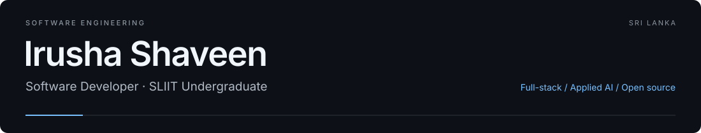

[LinkedIn](https://linkedin.com/in/irusha-dilshan-a15645354) &nbsp; / &nbsp; [Recca Labs](https://linkedin.com/company/recca-labs) &nbsp; / &nbsp; [Writing](https://irushashaveen.blogspot.com/) &nbsp; / &nbsp; [Email](mailto:it23768758@my.sliit.lk)

Software developer and **Software Engineering undergraduate at SLIIT**, Sri Lanka. I build full-stack products through **Recca Labs**, explore applied AI and contribute to open source.

### Currently

- **Research** — training physics-informed AI models for jet-engine diagnostics.
- **[ReMix](https://github.com/ReccaLabs/Remix)** — contributing to a tuition learning platform built with Next.js, NestJS and PostgreSQL.

### Stack

Also: Express · FastAPI · Laravel · C++ · Playwright · GitHub Actions

### WSO2 / Ballerina

Four contribution areas, with fixes and regression coverage submitted for review.

- **CSV record boundaries** — honor configured line terminators. [PR #88](https://github.com/ballerina-platform/module-ballerina-data.csv/pull/88)
- **CSV data preservation** — retain carriage returns in quoted fields. [PR #89](https://github.com/ballerina-platform/module-ballerina-data.csv/pull/89)
- **CSV diagnostics** — preserve fail-safe logs across processing stages. [PR #90](https://github.com/ballerina-platform/module-ballerina-data.csv/pull/90)
- **OpenAI API compatibility** — support maximum reasoning effort. [Chat #38](https://github.com/ballerina-platform/module-ballerinax-openai.chat/pull/38) · [Responses #6](https://github.com/ballerina-platform/module-ballerinax-openai.responses/pull/6)

---

[Public work](https://github.com/irushashaveen?tab=repositories) · [Contribution activity](https://github.com/irushashaveen?tab=overview) · Open to software engineering internships and collaboration.
