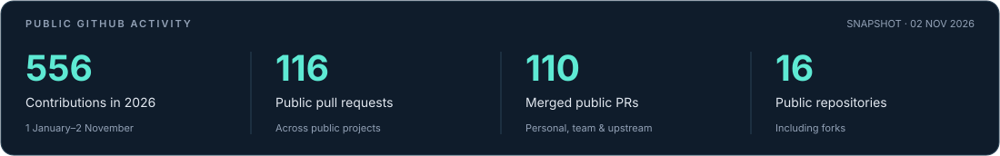

  

  <a href="https://linkedin.com/in/irusha-dilshan-a15645354">LinkedIn</a>
  &nbsp; · &nbsp;
  <a href="https://linkedin.com/company/recca-labs">Recca Labs</a>
  &nbsp; · &nbsp;
  <a href="https://irushashaveen.blogspot.com/">Technical blog</a>
  &nbsp; · &nbsp;
  <a href="mailto:it23768758@my.sliit.lk">Email</a>

## About

I'm **Irusha Shaveen**, a **Software Developer** and **Software Engineering undergraduate at SLIIT, Sri Lanka**. I build full-stack applications through **[Recca Labs](https://linkedin.com/company/recca-labs)** and contribute to collaborative projects and open-source libraries.

I enjoy connecting the pieces of an application: user interfaces, backend services, databases and automated tests. My work spans web platforms, API integrations, real-time data and browser automation.

- **Current focus:** Full-stack development, software quality and AI integrations.
- **How I work:** Understand the problem, make focused changes, test the behavior and document the decisions.
- **Community:** IEEE and IEEE Computer Society.

## Selected projects

Personal work and collaborative projects, with my contribution identified where the project is shared.

| Project | Stack | Work |
| --- | --- | --- |
| **[ReMix](https://github.com/ReccaLabs/Remix)** | Next.js · NestJS · PostgreSQL | Tuition learning platform at Recca Labs. Contributions include fees workflows, admin interfaces and API integrations. |
| **[Safe Zone](https://github.com/Vihanga-Deemantha/Disaster_Managment_System)** | React · TypeScript · Node.js · MongoDB | Team coursework project for disaster coordination. My work covers multi-agency resource allocation, dispatch workflows, UI and tests. |
| **[Quant Trader Python Engine](https://github.com/irushashaveen/quant-trader-python-engine)** | Python · FastAPI · WebSockets · Docker | Personal backend project exploring market-data APIs and real-time streaming with Pydantic schemas. |
| **[Playwright Testing Demo](https://github.com/irushashaveen/Payright)** | JavaScript · Playwright · GitHub Actions | Cross-browser automation for Chromium, Firefox and WebKit, with HTML reports and failure traces. |

## Tech stack

Technologies I work with and explore across personal and team projects.

| Area | Technologies |
| --- | --- |
| Languages | TypeScript · JavaScript · Java · Python · PHP · C++ · Ballerina |
| Frontend | React · Next.js · HTML · CSS |
| Backend | Node.js · Express · NestJS · FastAPI · Laravel |
| Data | PostgreSQL · MongoDB · MySQL · Redis |
| Testing | Playwright · Jest · Vitest |
| Tools & delivery | Git · GitHub Actions · Docker · AWS · Figma |

## GitHub activity

Snapshot: 2 November 2026. Contributions cover 1 January–2 November 2026. PR and repository counts are public totals and include personal, team and upstream work.

[All public PRs](https://github.com/search?q=author%3Airushashaveen+is%3Apr+is%3Apublic&type=pullrequests) · [Merged public PRs](https://github.com/search?q=author%3Airushashaveen+is%3Apr+is%3Amerged+is%3Apublic&type=pullrequests) · [Public repositories](https://github.com/irushashaveen?tab=repositories&type=public)

## Open-source contributions

Recent **submitted pull requests** to the Ballerina ecosystem, focused on reproducible fixes, regression tests and API compatibility. Follow the links for current review and merge status.

| Area | Contribution | Pull request |
| --- | --- | --- |
| CSV parsing | Honor configured line terminators. | [#88](https://github.com/ballerina-platform/module-ballerina-data.csv/pull/88) |
| CSV data preservation | Preserve carriage returns in quoted values and headers. | [#89](https://github.com/ballerina-platform/module-ballerina-data.csv/pull/89) |
| CSV error reporting | Retain fail-safe log entries across parsing and conversion stages. | [#90](https://github.com/ballerina-platform/module-ballerina-data.csv/pull/90) |
| OpenAI connectors | Add maximum reasoning effort support with HTTP-payload regression tests. | [Chat #38](https://github.com/ballerina-platform/module-ballerinax-openai.chat/pull/38) · [Responses #6](https://github.com/ballerina-platform/module-ballerinax-openai.responses/pull/6) |

---

  <strong>Open to software engineering internship opportunities and practical collaborations.</strong> 
  <a href="https://linkedin.com/in/irusha-dilshan-a15645354">Let's connect on LinkedIn</a>

